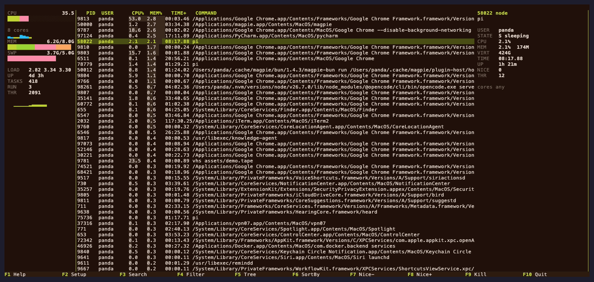
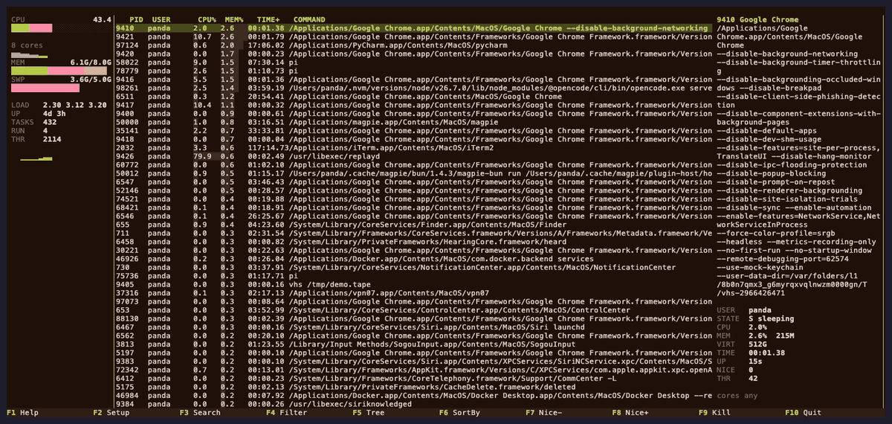
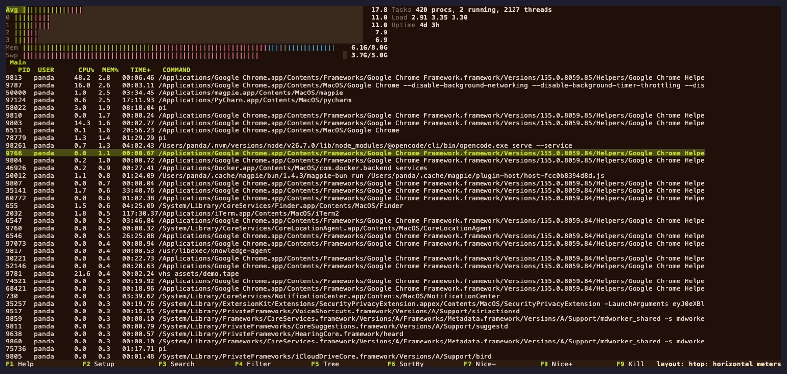
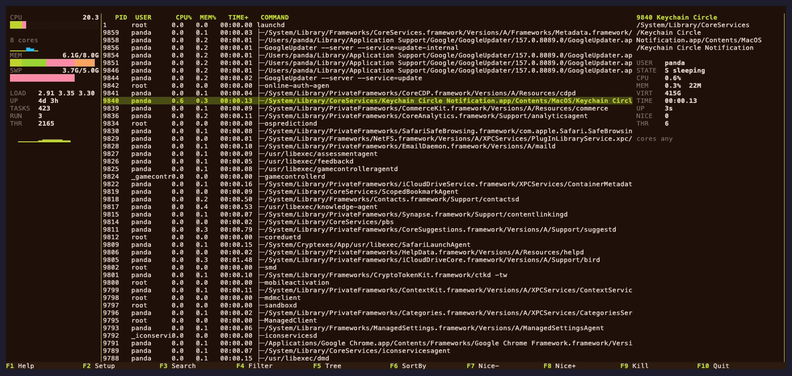

# gander

[](https://github.com/pandasir/gander/actions/workflows/ci.yml)
[](https://github.com/pandasir/gander/releases)
[](https://github.com/pandasir/gander/releases)
[](https://crates.io/crates/gander-bin)
[](LICENSE)
[](#平台支持)

[English](README.md) | **简体中文** | [日本語](README.ja.md) | [한국어](README.ko.md)

> **gander** 是一个用 Rust 编写的跨平台交互式进程查看器，支持 Linux、macOS 和
> FreeBSD。可以理解成 htop，但布局的重点是「一个进程」而不是「所有进程」。



```bash
brew install pandasir/tap/gander     # macOS
cargo install gander-bin             # 任何有 Rust 的平台
git clone https://github.com/pandasir/gander && cd gander/packaging/aur && makepkg -si   # Arch Linux
```

60 秒上手：安装后运行 `gander`，方向键选进程，按 `L` 切到经典 htop 布局，
`q` 退出。



gander 展示系统中正在运行的进程及其资源消耗。它支持 Linux、macOS 和 FreeBSD，
并沿用大部分 htop 按键。

## 特性

gander 默认使用 `panels` 布局：左侧是紧凑的系统栏，中间是进程表，右侧是实时检视
面板。检视面板跟随你选中的进程，命令行、状态、内存和运行时间不必离开列表就能看到。
按 `L` 可切换到经典的全宽 `htop` 布局。

`htop` 布局的每核排列与 htop 一致：八核以内每行一个，之后每行 2、4、8 个，所以
128 核机器只占 9 行表头，而不是 65 行。可在 `F2` -> Header 里直接选
`LeftCPUs8` 这类名字。

采样在后台运行，渲染端读取快照。脚本场景下，`--json`、`-n`、`--sort`、`--filter`
和 `--limit` 无需 TUI 即可使用。

Linux 上能看的内容更多：PSS/EPSS、PSI、zram/zswap、GPU、延迟统计和容器识别可作为
可选列或表头 meter 使用。各平台的后端读取各自的接口：Linux 用 `/proc`，macOS 用
`sysctl`/Mach/libproc，FreeBSD 用 `sysctl`/`libkvm`。

## 平台支持

| 能力 | Linux | macOS | FreeBSD |
|---|:---:|:---:|:---:|
| 进程、CPU 和内存视图 | 支持 | 支持 | 支持 |
| 主机网络吞吐 | 支持 | 支持 | 支持 |
| 主机磁盘吞吐（`DiskIO`） | 支持 | - | 支持 |
| 容器列 | 支持 | - | - |
| PSS / GPU / 延迟列 | 支持 | - | - |
| CPU 亲和性编辑 | 支持 | 仅提示 | 支持 |

其他 Unix 目标可能可以编译，但没有可用的实时后端。详见
[docs/PORTABILITY.md](docs/PORTABILITY.md)。

## 和其他工具比

如果你在挑 htop 的替代品，一句话版本：

| | gander | htop | btop | bottom |
|---|:---:|:---:|:---:|:---:|
| 终端界面 | 有 | 有 | 有 | 有 |
| Linux / macOS / FreeBSD | 全支持 | 全支持 | 部分 | 全支持 |
| 沿用 htop 按键 | 是 | - | 否 | 否 |
| 导入现有 `htoprc` | 是 | - | 否 | 否 |
| 选中的进程始终留在屏幕上 | 是 | 否 | 否 | 否 |
| 不是 htop 那种布局 | `panels` | - | 有 | 有 |
| `--json` 批处理模式 | 有 | 无 | 无 | 无 |

日常使用里真正有差别的是最后两行。htop、btop 和 bottom 回答「现在在跑什么」的
方式是先把所有进程铺开，你关心的那个进程的细节要么在另一个界面，要么没有。
gander 把检视面板放在进程表旁边，选中一行就直接得到答案，不用离开列表。如果你
本来就是冲着 htop 的排布来的，按 `L` 就切过去，按键也还在 htop 原来的位置。

## 安装

### 预编译二进制

从 [GitHub Releases](https://github.com/pandasir/gander/releases) 下载对应平台的
压缩包。

| 平台 | Target |
|---|---|
| macOS，Apple Silicon | `aarch64-apple-darwin` |
| macOS，Intel | `x86_64-apple-darwin` |
| Linux，x86_64，glibc | `x86_64-unknown-linux-gnu` |
| Linux，x86_64，静态链接 | `x86_64-unknown-linux-musl` |
| Linux，arm64，glibc | `aarch64-unknown-linux-gnu` |
| Linux，arm64，静态链接 | `aarch64-unknown-linux-musl` |
| FreeBSD | `x86_64-unknown-freebsd` |

Release 还会在压缩包旁提供 Linux x86_64 与 arm64 的 `.deb` 和 `.rpm` 包，见
[Debian/Ubuntu 与 Fedora/RHEL](#debianubuntu-与-fedorarhel)。

```bash
tar -xzf gander-<version>-<target>.tar.gz
./gander-<version>-<target>/gander
```

安装到 `PATH`：

```bash
mkdir -p ~/.local/bin
install -m755 gander-<version>-<target>/gander ~/.local/bin/gander
```

musl 版本为静态链接，不依赖宿主机的 glibc。每个压缩包旁都有对应的 `.sha256`
校验文件。

### Debian/Ubuntu 与 Fedora/RHEL

两个发行版都有签名软件源，`apt` 和 `dnf` 可以像普通软件包一样安装和升级 gander。

```bash
# Debian、Ubuntu、Linux Mint 等
sudo mkdir -p /usr/share/keyrings
curl -fsSL https://pandasir.github.io/gander/gander.gpg \
  | sudo gpg --dearmor -o /usr/share/keyrings/gander.gpg
echo "deb [signed-by=/usr/share/keyrings/gander.gpg] https://pandasir.github.io/gander stable main" \
  | sudo tee /etc/apt/sources.list.d/gander.list
sudo apt update && sudo apt install gander

# Fedora、RHEL、Rocky、Alma、openSUSE 等
sudo rpm --import https://pandasir.github.io/gander/RPM-GPG-KEY-gander
sudo curl -fsSL https://pandasir.github.io/gander/gander.repo \
  -o /etc/yum.repos.d/gander.repo
sudo dnf install gander
```

之后用 `apt upgrade` / `dnf upgrade` 升级即可。软件源已签名并由客户端校验：
`apt` 校验 `InRelease`，`dnf` 以 `gpgcheck=1` 和 `repo_gpgcheck=1` 运行。

如果不想添加软件源，Release 仍然直接提供安装包：

```bash
sudo apt install ./gander_<version>-1_amd64.deb      # ARM 机器用 arm64
sudo dnf install ./gander-<version>-1.x86_64.rpm     # ARM 机器用 aarch64
```

旁边的 `SHA256SUMS` 覆盖所有安装包。

### 包管理器

| 方式 | 命令 |
|---|---|
| Debian、Ubuntu | `sudo apt install gander` |
| Fedora、RHEL、Rocky | `sudo dnf install gander` |
| Homebrew | `brew install pandasir/tap/gander` |
| crates.io | `cargo install gander-bin` |
| Arch Linux | `git clone https://github.com/pandasir/gander && cd gander/packaging/aur && makepkg -si` |

目前没有 AUR 包。自 2026 年 6 月的[恶意包事件](https://archlinux.org/news/active-aur-malicious-packages-incident/)
之后，AUR 账号注册一直关闭，Arch 的 DevOps 团队也说明目前没有人工开通的途径，
所以这个包无法提交。上面的 Arch 安装方式用的是同一个 `PKGBUILD`，build 出来的
包与本应发布到 AUR 的完全一致。等注册重新开放时会提交到 AUR，并在这里写明。

crates.io 上的包名是 `gander-bin`，因为 `gander` 已被一个无关的 crate 占用；
安装后的命令仍然是 `gander`。

### 从源码构建

需要 **Rust 1.89+**，不需要 ncurses 或 libcurses 开发头文件。

```bash
git clone https://github.com/pandasir/gander
cd gander
cargo install --locked --path crates/bin
```

也可以不安装，直接运行：

```bash
cargo run --release -p gander-bin
```

## 快速开始

```bash
gander                                     # 交互式 TUI
gander --delay 500                         # 每 500 毫秒采样一次
gander -n 5 -d 1000                        # 输出 5 次文本采样
gander --json --limit 10                   # 输出一次 JSON
gander --sort PERCENT_MEM --limit 20       # 按内存排序取前 20
gander -F "python|node"                    # 过滤命令行
gander --import-htoprc ~/.config/htop/htoprc --save
```

过滤词是大小写不敏感的固定字符串，使用 `|` 分隔，不是正则表达式。完整参数见
`gander --help`。

## 界面与按键

`panels` 是默认布局，`htop` 是经典的全宽布局。按 `L` 切换，gander 会记住你的
选择。

| `panels`（默认） | `htop`（`L`） | `t` 树状视图 |
|---|---|---|
|  |  |  |

| 按键 | 作用 |
|---|---|
| `F1` / `h` / `?` | 帮助 |
| `F2` | 设置 |
| `F3` / `/` | 搜索 |
| `F4` / `\` | 过滤 |
| `F5` / `t` | 树状视图 |
| `F6` / `<` `>` | 切换排序列 |
| `F9` / `k` | 发送信号 |
| `F10` / `q` | 退出 |

与 htop 不同的按键：

| 按键 | gander |
|---|---|
| `I` | 切换当前选中表头 meter 的显示模式 |
| `+` / `-` | 加快 / 放慢采样 |
| `L` | 切换布局 |
| `Shift+Left` / `Shift+Right` | 移动表头 meter 光标 |

htop 的 `I` 用于反转排序；在 gander 中请使用 `F6` / `<` `>` / `.`。完整按键表见
[docs/KEYS.md](docs/KEYS.md)。

## 配置

配置为 TOML 格式，路径优先使用 `$GANDER_CONFIG`，否则为
`$XDG_CONFIG_HOME/gander/config.toml`（回退到 `~/.config/gander/config.toml`）。
每个标签页各自保留列与排序，表头 meter 及其显示模式也可配置。设置仅在正常退出时
写入，并以原子替换方式保存。配置文件不存在时使用默认值；无法读取、格式错误或配置
无效时会报错退出，不会用默认配置覆盖原文件。

`system_cores_max` 限制 `panels` 布局系统栏里每核心网格的格数。默认 `0` 表示
“不限”，按终端高度能放多少就画多少；终端太矮时网格会提前结束，此时标签显示
`64/128 cores`，不会把被截断的网格误报成 64 核机器。同一项也可在
`F2` -> Display 中切换。

gander 将搜索与过滤历史存放在 `$XDG_STATE_HOME/gander/`（回退到
`~/.local/state/gander/`）。

可用主题：`gander`、`default`、`monochrome`、`midnight`、`classic`、`verdant`、
`paper`、`quiet`。可在 `F2` -> Colors 中选择，或在配置中设置 `color_scheme`。

## Linux 专用数据

- `M_PSS`、`M_EPSS`、`M_PRIVATE`、`M_SWAP`：按需读取 `smaps_rollup`；未测量的
  值显示 `-`，而不是 `0`。
- `GPU%`、`GPU_TIME`：从 `drm-usage-stats` 读取，无需厂商 SDK。
- `CPUD%`、`IOD%`、`SWPD%`：TASKSTATS 延迟统计，需要 `CAP_NET_ADMIN`。
- `CONTAINER`、`CGROUP`：结合 cgroup 路径与 PID namespace 进行识别。
- `PSI`、`Zram`、`Zswap`、`HugePages`：可选表头 meter。

可在 `F2` -> Columns 或 `F2` -> Header 中启用。实现细节见
[docs/DESIGN.md](docs/DESIGN.md) 和 [docs/PORTABILITY.md](docs/PORTABILITY.md)。

## 开发

工作区分为四个 crate：

| Crate | 职责 |
|---|---|
| `gander-core` | 平台采样、解析、进程模型与操作 |
| `gander-config` | TOML 设置、历史记录与 `htoprc` 导入 |
| `gander-tui` | 渲染、布局、输入与运行时 |
| `gander-bin` | 命令行、批量输出与可执行文件 |

```bash
cargo build --locked
cargo test --locked --workspace
cargo clippy --locked --workspace --all-targets -- -D warnings
cargo bench -p gander-core
```

macOS 实时测试会读取系统进程表，可能需要在非受限沙箱中运行。完整开发与评审流程见
[CONTRIBUTING.md](CONTRIBUTING.md)。

## 文档

| 文档 | 内容 |
|---|---|
| [assets/README.md](assets/README.md) | 截图和重新生成它们的方法 |
| [docs/KEYS.md](docs/KEYS.md) | 完整按键表与批量模式 |
| [docs/LAYOUT.md](docs/LAYOUT.md) | `panels` 布局与窄终端降级 |
| [docs/PORTABILITY.md](docs/PORTABILITY.md) | 后端矩阵与平台限制 |
| [docs/DESIGN.md](docs/DESIGN.md) | 架构与数据模型 |
| [docs/ROADMAP.md](docs/ROADMAP.md) | 已完成里程碑与后续计划 |
| [CHANGELOG.md](CHANGELOG.md) | 版本历史 |

## 常见问题

**gander 能替代 htop 吗？**
能，也不能。它读的是同一份 `/proc` 数据，按键也照 htop 摆，所以你现在的工作方式
不用改；`--import-htoprc` 能把你的 htop 设置直接搬过来。但默认布局故意不是 htop
那种，因为「全宽表格 + 第二个界面看细节」并不是读进程列表的唯一方式。

**支持 Windows 吗？**
不支持。三个后端分别是 `/proc`（Linux）、`sysctl`/Mach/libproc（macOS）和
`sysctl`/`libkvm`（FreeBSD），没有 Windows 后端。依赖 Linux 内核接口的列（PSS、
PSI、zram、延迟统计、容器）也只在 Linux 上有。

**为什么 crates.io 上的包叫 `gander-bin`？**
因为 crates.io 上的 `gander` 是一个无关的、早已 yank 的包。装完命令仍然是
`gander`。

**为什么不用 ncurses？**
渲染用的是 [ratatui](https://ratatui.rs) 和
[crossterm](https://github.com/crossterm-rs/crossterm)，编译前不需要装 ncurses
开发头文件。

**能用在脚本里吗？**
能。`gander --json`、`-n`、`--sort`、`--filter` 和 `--limit` 不启动 TUI，直接
输出每个进程一行。

## 参与贡献

欢迎提交 bug 报告、平台观察结果和聚焦的 pull request。请先阅读
[CONTRIBUTING.md](CONTRIBUTING.md)。安全漏洞请按 [SECURITY.md](SECURITY.md) 私下
报告，不要开公开 issue。

## 许可证

GPL-2.0-or-later。gander 的行为、按键绑定和列语义取自 htop；请保持许可证兼容并
注明出处。
